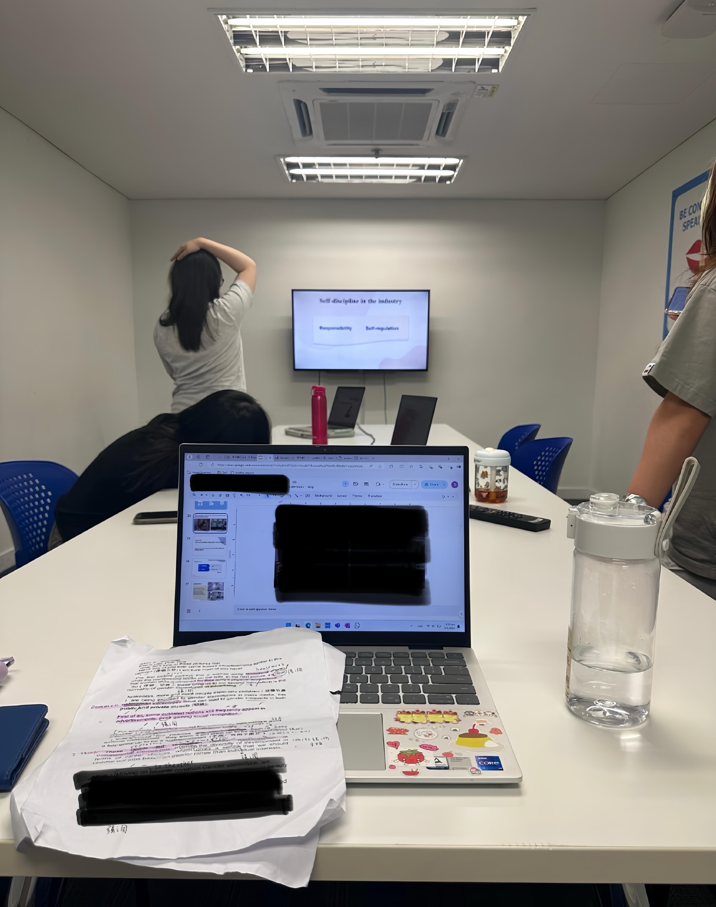

# BigRig Mover Database

[Open the notebook portfolio](https://xushuqing0575.github.io/#bigrig)

I worked on the database side of BigRig Mover: how quotations, jobs, staff and transport resources fit together, and how to get useful answers out of them.

The SQL was only part of it. We had a presentation to get ready for, too.😛

*The people behind the database part.*

## My focus

Relational design, Oracle SQL, data manipulation, reporting queries and a JSON-to-MongoDB workflow. The underlying database artefacts were completed in a university database project. My portfolio also records my database-team volunteer experience; this writeup does not treat coursework scripts as proof of an independently deployed client system.

## From business records to reports

The original scripts cover schema constraints, inserting related records, data modifications, schema changes and reporting. A customer report resolves business or personal names with a CASE expression, groups quotations by customer and compares each customer's average quoted cost with the overall average. Other reports investigate employee assignments and operational resources.

NULL values and missing matches matter here. An absent name component should not silently erase a readable customer name, and a report that uses an inner join should be explicit about which records it excludes.

## Original script map

- `T1-brm-schema.sql` — schema completion and integrity constraints
- `T2-brm-insert.sql` — inserting linked records
- `T3-brm-dm.sql` — data manipulation
- `T4-brm-mods.sql` — schema modifications
- `T5-brm-select.sql` — business reporting queries
- `T6-brm-json.sql` — JSON export
- `T6-brm-mongo.mongodb.js` — MongoDB operations

This public repository contains the writeup, portfolio notebook and project photos. It does not redistribute the course-provided schema, teaching material, student identifiers or an operational customer database.

## Reading the work

Start with `project.ipynb` or the linked portfolio. To reproduce the original SQL workflows, an Oracle environment and the matching original schema are required; MongoDB tasks additionally require an appropriate MongoDB collection. The notebook is an overview and does not connect to a live production database.

## Design considerations

Use foreign keys and constraints to protect relationships before building aggregate reports. Keep changes transactional. Check the grain of joined tables so that one-to-many relationships do not accidentally multiply counts. Validate JSON structure before treating an export as a document model.

---
Chloe Shuqing Xu · [GitHub](https://github.com/xushuqing0575)
